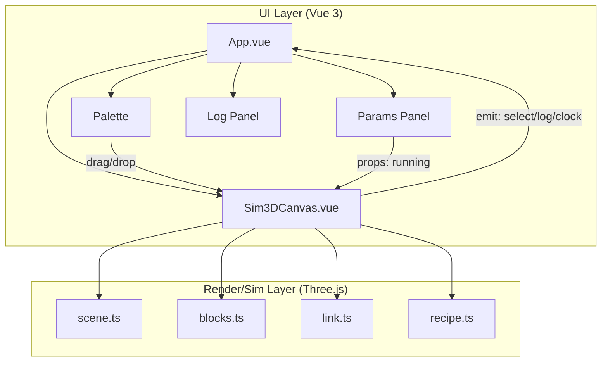

# Data Structure 3D Simulator (data-structure-sim)

> **Understand data structures, block by block.**

A block-based data-flow simulator for data structures, built with **Vue 3 + Three.js**. Drag data-structure "blocks" into a 3D scene, wire them together into pipelines, hit Run, and watch data flow through stacks, queues, trees, hash maps, and more — with real-time transfer animations and congestion visualization.

> 🎮 **Live Demo**: <https://kowasaretaneko17.github.io/data-structure-sim/>

[](https://kowasaretaneko17.github.io/data-structure-sim/)
[](https://github.com/kowasaretaneko17/data-structure-sim/actions)

> Version: 0.1.0 · Stack: Vue 3 / TypeScript / Three.js / Vite

---

## Table of Contents

- [Features](#features)
- [Quick Start](#quick-start)
- [Tech Stack](#tech-stack)
- [Architecture](#architecture)
- [Core Design](#core-design)
  - [Blocks](#blocks)
  - [Links & Transfer Animation](#links--transfer-animation)
  - [Simulation Engine](#simulation-engine)
  - [Composite Components (Recipes)](#composite-components-recipes)
  - [3D Scene & Camera](#3d-scene--camera)
- [Interaction Guide](#interaction-guide)
- [Block Reference](#block-reference)
- [Project Structure](#project-structure)
- [Extension Guide](#extension-guide)
- [Docs](#docs)

---

## Features

- **20+ data-structure blocks**: array, stack, queue, linked list, hash map, skip list, tree, B-tree, B+ tree, red-black tree, BST, AVL tree, deque, circular queue, trie, union-find, heap, graph, plus source/sink nodes.
- **Block-based visual modeling**: drag or click to place blocks in the 3D scene; connect from orange (output) ports to blue (input) ports to build arbitrary data pipelines.
- **Data-flow simulation engine**: drives data through structures on a fixed tick (900ms/step), with glowing dots animating along links.
- **Semantic fidelity**: stacks follow LIFO, queues follow FIFO, heaps sift up on insert, skip lists / trees keep sorted order — approximating real behavior.
- **Two link modes**:
  - **Transfer (consume)**: data is taken from the source and moved downstream;
  - **Store (persistent)**: acts as a storage target; data is not consumed.
- **Live parameter tuning**: capacity, flow rate, and consumption speed via sliders.
- **Composite components**: box-select multiple blocks and pack them into a "black box"; double-click to expand/collapse and inspect the internals.
- **Congestion visualization**: when downstream is full, the upstream block pulses with a red outline.
- **Operation log**: records every emit / enqueue / dequeue / receive event per step.

---

## Quick Start

```bash
npm install      # install dependencies
npm run dev      # start the dev server

npm run build    # type-check + production build
npm run preview  # preview the build
npm test         # run tests
```

Open the URL printed by Vite (default `http://localhost:5173`).

---

## Tech Stack

| Category | Technology | Purpose |
| --- | --- | --- |
| UI framework | Vue 3 (`<script setup>`) | Components, state, event flow |
| 3D rendering | Three.js `0.170` | Scene, block meshes, link animation, raycasting |
| Language | TypeScript (strict) | Type safety |
| Build | Vite 5 + `@vitejs/plugin-vue` | Dev & build |
| Type checking | vue-tsc | `--noEmit` check before build |
| Testing | Vitest | Unit tests |

---

## Architecture



**Data flow**:

```
Palette drag/click ──▶ Sim3DCanvas.addBlock / addCompositeBlock
                            │
                            ▼
                   Scene (blocks + links)
                            │
               Run button ──▶ startSim()
                            │
                            ▼
                 simStep() every 900ms
                            │
        ┌───────────────────┼───────────────────┐
        ▼                   ▼                   ▼
   extractValue      startTransfer(dot)     insertValue
        │                   │                   │
        └───────── update filled ──▶ refresh meshes / congestion / log
```

---

## Core Design

### Blocks

`src/three/blocks.ts` is the data model and mesh factory.

- **`BlockType`**: a union type declaring 21 block kinds (including `source`, `sink`, `composite`).
- **`BlockParams`**: runtime parameters — `capacity`, `filled`, `speed` (source flow rate / sink consumption speed), `values` (stored data), `skipLevels` (skip-list promotion levels).
- **`DEFAULT_PARAMS` / `PARAM_META`**: defaults and slider metadata.
- **`BLOCK_INFO`**: names and hover descriptions.
- **`BLOCK_COLORS`**: per-block theme colors.

Each block is produced by `createBlock(type, params)`, returning a `BlockInstance` (`group` + input/output port positions). Meshes are assembled from primitives:

| Primitive | Purpose |
| --- | --- |
| `createSlot` | white flat slot + border |
| `createFill` | colored fill covering an occupied slot |
| `createDot` | flat cylinder for nodes / elements / ports |
| `createNumberSprite` | Canvas-texture sprite for numeric labels |
| `createLink` | thin cylinder connecting two points |
| `addPorts` | adds input (blue) / output (orange) port dots |

Layout algorithms include: array (row of slots), stack (vertical slots), queue (row with head on the right), linked list (dots + sequential links), hash map (`key % buckets`), skip list (3-tier index with random promotion), tree (level-order layout), BST (right-skewed chain to show degeneration), AVL / red-black tree (`generateTreeLayout` + `inorderToLevelOrder`), B-tree (root separator keys + 4 range children), B+ tree (root index + linked leaves), heap (pyramid), graph (center + ring + edges).

### Links & Transfer Animation

`src/three/link.ts`'s `createDataLink` returns a `DataLink` with three visual layers:

1. **Thin line** (`Line`) — visible connector;
2. **Transparent pick cylinder** (`opacity = 0`) — raycast target for selection;
3. **Glowing dot** (`Cylinder`) — represents one in-transit datum, interpolated along endpoints.

Key mechanics:

- **Dynamic endpoints**: `getFrom` / `getTo` callbacks read port world positions every frame, so links follow moving blocks.
- **`startTransfer(onDone)`**: begins a transfer, sets `busy = true`, shows the dot.
- **`update(dt)`**: refreshes endpoints each frame; while busy, lerps the dot along; on `t >= 1`, fires `onDone` (the datum actually lands downstream).
- **`setStore(store)`**: switches to store mode, recoloring the link purple (`0x8a5cf6`).
- **`setHighlight(hl)`**: highlights the selected link blue.

### Simulation Engine

Driven by `setInterval(simStep, 900)` in `Sim3DCanvas.vue`:

```
simStep():
  simStepCount += 1 (emit clock)
  for each link:
    if link.data.isBusy() → skip (previous transfer in flight)
    find from / to blocks
    hasData:
      - source: values non-empty AND step % speed === 0 (throttled)
      - others: values.length - inTransit > 0 AND not a store target
    toFull: sink never full; others: values.length >= capacity
    if !hasData or toFull → continue (stalled)
    value = extractValue(from)
    log (emit / dequeue)
    from.inTransit += 1
    data.startTransfer(callback):
      from.inTransit -= 1
      insertValue(to, value)
      log (enqueue / receive)
      syncFilled + refreshBlocks
  syncFilled + refreshBlocks + updateCongestion
```

**Semantic functions**:

- `insertValue(block, value)`:
  - `heap` → `push` + `heapifyUp` (max-heap sift-up);
  - `skipList` → sorted insert + random promotion level;
  - `redBlackTree / bst / avlTree / bTree / bPlusTree` → sorted insert;
  - others → `push`.
- `extractValue(block)`:
  - `stack` → `pop()` (LIFO);
  - others → `shift()` (FIFO / heap top / minimum).

The `inTransit` field tracks data currently on links to avoid double-extraction.

### Composite Components (Recipes)

`src/three/recipe.ts` defines the composite "recipe":

```ts
interface Recipe {
  name: string;
  blocks: RecipeBlock[];
  links: RecipeLink[];
  inPort: number;   // maps external input port to an inner block index
  outPort: number;  // maps external output port to an inner block index
  shape?: 'box' | 'bucket';
}
```

**Packing** (`packSelected`): box-select ≥2 blocks → identify internal links → infer input block (no internal in-edge) and output block (no internal out-edge) → create `Recipe` → replace blocks with a black-box `composite`.

**Expand/collapse** (double-click): expand replaces the black box with full-size inner blocks/links and redirects external links to inner in/out blocks; collapse removes the inners and restores the black box.

---

## 3D Scene & Camera

`src/three/scene.ts`'s `createScene3D` creates a **2D top-down scene**:

- **Orthographic camera** (`frustumSize = 22`), positioned at `(0, 20, 0)` looking down, `up = (0, 0, -1)`;
- **Grid floor**: `GridHelper` (60×60) + light plane;
- **OrbitControls**: rotation disabled, pan/zoom only (`minZoom 0.4` / `maxZoom 3`), damping enabled;
- **Render loop**: `renderer.setAnimationLoop` updates controls and all `onUpdate` callbacks each frame;
- **Responsive**: `ResizeObserver` updates camera and renderer on container resize;
- **`onUpdate(fn)`**: registers per-frame callbacks and returns an unregister function for cleanup.

---

## Interaction Guide

| Action | Effect |
| --- | --- |
| Drag palette block onto canvas | Create block at drop point |
| Click palette block | Create block at auto-grid position |
| Drag from **orange port** to **blue port** | Create a transfer link |
| Drag block body | Move block; links follow |
| Drag on empty space | Box-select multiple blocks (green) |
| Click block | Select (blue); params panel shows sliders |
| Click link | Select; toggle transfer/store mode |
| Double-click composite | Expand/collapse internals |
| `Delete` / `Backspace` | Delete selected block or link |
| Run button | Start/stop simulation (900ms step) |
| Pack button | Pack selected blocks into a composite |

**Port convention**: orange = output (data out), blue = input (data in).

**Congestion rule**: when upstream has data and downstream is full, the upstream block pulses red, indicating a stall.

---

## Block Reference

| Type Key | Name | Icon | Notes |
| --- | --- | --- | --- |
| `source` | Source | 📤 | Generates messages |
| `sink` | Sink | 📥 | Absorbs data |
| `array` | Array | 🔢 | Contiguous memory, O(1) random access |
| `stack` | Stack | 📚 | LIFO |
| `queue` | Queue | 🚶 | FIFO |
| `linkedList` | Linked List | 🔗 | Pointer-chained |
| `hashMap` | Hash Map | 🗂️ | `key % buckets` hashing |
| `skipList` | Skip List | ⛷️ | Multi-level index |
| `tree` | Tree | 🌳 | Level-order fill |
| `bTree` | B-Tree | 🅱️ | Multi-way balanced |
| `bPlusTree` | B+ Tree | ➕ | Index + linked leaves |
| `redBlackTree` | Red-Black Tree | 🔴 | Alternating red/black nodes |
| `bst` | BST | 🌲 | Sorted insert → right-skewed |
| `avlTree` | AVL Tree | ⚖️ | Balanced layout |
| `deque` | Deque | ↔️ | Both ends |
| `circularQueue` | Circular Queue | 🔄 | Ring buffer |
| `trie` | Trie | 🔤 | Prefix grouping |
| `unionFind` | Union-Find | 👥 | `v % 3` grouping |
| `heap` | Heap | ⛰️ | Max-heap sift-up |
| `graph` | Graph | 🕸️ | Center + ring + edges |
| `composite` | Composite | 🧩 | Packed subgraph |

---

## Project Structure

```
data-structure-sim/
├── index.html
├── package.json
├── tsconfig.json
├── vite.config.ts
├── docs/
│   ├── architecture.md     # architecture design (with Mermaid diagrams)
│   └── user-guide.md       # user manual
├── src/
│   ├── main.ts
│   ├── App.vue
│   ├── style.css
│   ├── env.d.ts
│   ├── components/
│   │   └── Sim3DCanvas.vue
│   └── three/
│       ├── scene.ts
│       ├── blocks.ts
│       ├── link.ts
│       └── recipe.ts
└── dist/
```

---

## Extension Guide

### Add a new data-structure block

1. In `src/three/blocks.ts`:
   - add the new type to `BlockType`;
   - add entries to `DEFAULT_PARAMS`, `PARAM_META`, `BLOCK_INFO`, `BLOCK_COLORS`;
   - write a `createXxxBlock(params)` mesh function;
   - wire it into the `switch` in `createBlock`;
2. Optionally add access semantics in `insertValue` / `extractValue` in `Sim3DCanvas.vue`;
3. Add a palette entry in `App.vue`'s `BLOCKS` array.

### Tune the simulation pace

Change the `setInterval(simStep, 900)` interval in `Sim3DCanvas.vue`, or make it configurable.

### Add composite shapes

Add a new `shape` branch in `createCompositeBlock` and declare it in `Recipe.shape`.

### Add preset composites

`src/three/recipe.ts`'s `RECIPES` starts empty — add presets conforming to `Recipe` and they will appear in the palette.

---

## Docs

- [架构设计文档（中文）](docs/architecture.md) — Architecture design with Mermaid diagrams.
- [用户手册（中文）](docs/user-guide.md) — User manual.
