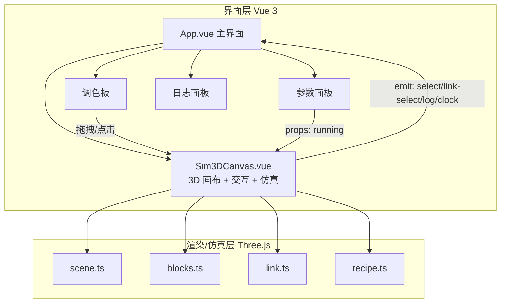
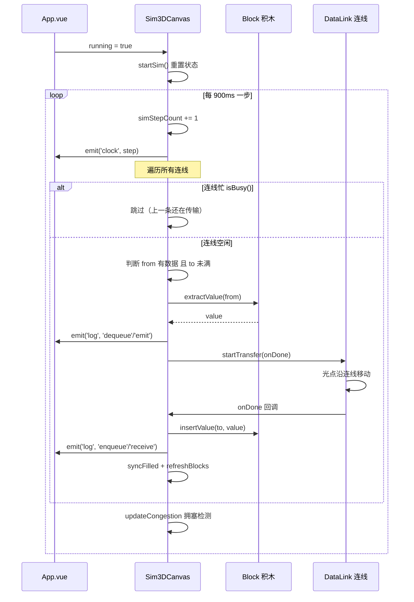

# 数据结构 3D 仿真（data-structure-sim）

> **像搭积木一样，看懂数据结构。**

一个基于 **Vue 3 + Three.js** 的「积木式」数据结构数据流仿真器。用户像搭积木一样把各种数据结构拖入 3D 场景，用连线把它们串成流水线，点击运行即可直观观察数据在栈、队列、树、哈希表等结构之间的流动、存取与拥塞情况。

> 🎮 **在线体验**：<https://kowasaretaneko17.github.io/data-structure-sim/>

[](https://kowasaretaneko17.github.io/data-structure-sim/)
[](https://github.com/kowasaretaneko17/data-structure-sim/actions)

> 版本：0.1.0 · 技术栈：Vue 3 / TypeScript / Three.js / Vite

---

## 目录

- [功能特性](#功能特性)
- [快速开始](#快速开始)
- [技术栈](#技术栈)
- [项目架构](#项目架构)
- [核心设计](#核心设计)
  - [积木（Block）](#积木block)
  - [连线（Link）与传输动画](#连线link与传输动画)
  - [仿真引擎](#仿真引擎)
  - [复合组件（Recipe）](#复合组件recipe)
  - [3D 场景与相机](#3d-场景与相机)
- [交互操作指南](#交互操作指南)
- [数据结构积木清单](#数据结构积木清单)
- [目录结构](#目录结构)
- [扩展指南](#扩展指南)
- [相关文档](#相关文档)

---

## 功能特性

- **20+ 种数据结构积木**：数组、栈、队列、链表、哈希表、跳表、树、B 树、B+ 树、红黑树、二叉搜索树、AVL 树、双端队列、循环队列、字典树、并查集、堆、图，以及源节点 / 汇节点。
- **积木式可视化建模**：拖拽或点击将积木放入 3D 场景，从「橙端口（输出）」到「蓝端口（输入）」拖线连接，自由搭建任意数据流水线。
- **数据流仿真引擎**：按固定步长（900ms/步）驱动数据在结构间流动，光点沿连线动画传输。
- **结构语义模拟**：入栈出栈遵循 LIFO、队列遵循 FIFO、堆插入做上浮、跳表 / 树类结构保持有序插入，尽可能还原各数据结构的真实行为。
- **两种连线模式**：
  - **传输（消耗）**：数据从上游取出并转移到下游；
  - **存储（持久化）**：作为存储目标，数据不被消耗。
- **参数调节**：容量、流速、消耗速度等均可通过滑块实时调整。
- **复合组件（打包/展开）**：框选多个积木一键打包成「黑盒」组件，双击可展开/折叠查看内部结构。
- **拥塞可视化**：下游已满时，上游积木被红色闪烁框高亮提示「滞涩」。
- **操作日志**：实时记录每一步的投递、入队、出队、接收事件。

---

## 快速开始

```bash
# 安装依赖
npm install

# 启动开发服务器
npm run dev

# 类型检查 + 构建
npm run build

# 预览构建产物
npm run preview

# 运行测试
npm test
```

启动后浏览器打开 Vite 输出的地址（默认 `http://localhost:5173`），即可在 3D 画布中搭建数据流。

---

## 技术栈

| 类别 | 技术 | 用途 |
| --- | --- | --- |
| 前端框架 | Vue 3（`<script setup>`） | 界面组件、状态管理、事件通信 |
| 3D 渲染 | Three.js `0.170` | 场景、积木建模、连线动画、射线拾取 |
| 语言 | TypeScript（strict） | 类型安全 |
| 构建 | Vite 5 + `@vitejs/plugin-vue` | 开发与打包 |
| 类型检查 | vue-tsc | 构建前 `--noEmit` 校验 |
| 测试 | Vitest | 单元测试 |

---

## 项目架构

整体采用「**Vue 界面层 + Three.js 渲染/仿真层**」的分层设计：

```
App.vue（主界面）
 ├── 工具栏（运行/停止、打包、时钟、提示）
 ├── 调色板 Palette（积木列表 + 复合组件列表）
 ├── Sim3DCanvas.vue（3D 画布 + 全部交互逻辑）
 │    ├── three/scene.ts   → 场景、正交相机、轨道控制、渲染循环
 │    ├── three/blocks.ts  → 积木类型定义 + 3D 造型工厂
 │    ├── three/link.ts    → 数据连线 + 传输动画
 │    └── three/recipe.ts  → 复合组件配方数据结构
 ├── 参数面板（容量/流速调节、连线模式切换）
 └── 日志面板（操作日志）
```



**数据流方向**：

```
调色板拖拽/点击 ──▶ Sim3DCanvas.addBlock / addCompositeBlock
                           │
                           ▼
                  场景 Scene（积木 + 连线）
                           │
               点击「运行」──▶ startSim()
                           │
                           ▼
                 simStep() 每 900ms 执行一步
                           │
          ┌────────────────┼────────────────┐
          ▼                ▼                ▼
     取出数据(extract)  光点动画(startTransfer)  写入数据(insert)
          │                │                │
          └──────── 更新 filled ──▶ 刷新 3D 造型 / 拥塞检测 / 日志
```

---

## 核心设计

### 积木（Block）

`src/three/blocks.ts` 是整个系统的数据模型与造型工厂。

- **`BlockType`**：联合类型，声明了 21 种积木（含 `source`、`sink`、`composite`）。
- **`BlockParams`**：积木运行参数，包括：
  - `capacity` 容量 / `filled` 当前数据量；
  - `speed`（源节点的流速、汇节点的消耗速度）；
  - `values` 当前存储的具体数据值；
  - `skipLevels`（跳表每个元素的晋升层数）。
- **`DEFAULT_PARAMS` / `PARAM_META`**：各积木的默认参数与参数面板元信息（标签、滑杆范围）。
- **`BLOCK_INFO`**：积木名称与悬浮说明文案。
- **`BLOCK_COLORS`**：每种积木的主题色。

每个积木由 `createBlock(type, params)` 返回 `BlockInstance`（`group` + 输入/输出端口坐标）。造型全部由基础几何体拼装：

| 造型原语 | 说明 |
| --- | --- |
| `createSlot` | 白色扁平格子 + 边框，表示「槽位」 |
| `createFill` | 彩色填充块，盖在槽位上表示「已占用」 |
| `createDot` | 扁平圆点，表示节点 / 元素 / 端口 |
| `createNumberSprite` | Canvas 纹理 Sprite，绘制数字标签 |
| `createLink` | 两端之间的细圆柱连线 |
| `addPorts` | 在积木左右两侧添加输入（蓝）/输出（橙）端口圆点 |

各数据结构积木拥有各自的布局算法，例如：

- **数组**：一排槽位；
- **栈**：纵向槽位（LIFO 顶在近端）；
- **队列**：横排槽位，队首在右、从右向左消耗；
- **链表**：圆点 + 顺序连线；
- **哈希表**：按 `key % 桶数` 散落到各桶；
- **跳表**：三层索引，基于 `skipLevels` 随机晋升；
- **树 / AVL / 红黑树**：层级布局（`generateTreeLayout` + `inorderToLevelOrder`）；
- **二叉搜索树**：升序插入退化为右斜链，直观展示退化问题；
- **B 树**：根节点分隔键 + 4 个子节点按区间分布；
- **B+ 树**：根索引（路由键）+ 叶子节点链表连接；
- **堆**：金字塔排列，插入时 `heapifyUp` 维持大顶堆；
- **图**：中心节点 + 环形分布节点 + 边。

### 连线（Link）与传输动画

`src/three/link.ts` 的 `createDataLink` 返回 `DataLink` 对象，由三层视觉组成：

1. **细线**（`Line`）：连接两端点的可见线；
2. **透明粗拾取管**（透明 `Cylinder`）：仅供 raycast 命中，便于点击选中连线；
3. **光点**（`Cylinder`）：代表「一条正在传输的数据」，传输时沿两端点插值移动。

关键机制：

- **端点动态获取**：通过 `getFrom` / `getTo` 回调实时读取两端端口的世界坐标，积木移动后连线自动跟随；
- **`startTransfer(onDone)`**：启动一次传输，`busy = true`，光点可见；
- **`update(dt)`**：每帧刷新端点，`busy` 时令光点 `lerpVectors` 前进，`t` 到 1 时触发 `onDone` 回调（即数据真正写入下游）；
- **`setStore(store)`**：存储模式切换，连线颜色变为紫色（`0x8a5cf6`）；
- **`setHighlight(hl)`**：选中时连线高亮为蓝色。

### 仿真引擎

仿真逻辑位于 `Sim3DCanvas.vue` 中，由 `setInterval(simStep, 900)` 驱动：

```
simStep():
  simStepCount += 1（时钟 +1，emit 给界面）
  遍历所有 link：
    若 link.data.isBusy() → 跳过（上一条还在传输）
    找到 from / to 积木
    判断上游是否有数据（hasData）
       - source：values 非空且步数 % speed === 0（按流速节流）
       - 其他：values.length - inTransit > 0 且非「存储目标」
    判断下游是否已满（toFull）
       - sink 永不满；其他看 values.length >= capacity
    若无数据或下游满 → continue（滞涩）
    取出数据 extractValue(from)
    记录日志（emit / dequeue）
    from.inTransit += 1
    data.startTransfer(完成回调):
       from.inTransit -= 1
       insertValue(to, value)
       记录日志（enqueue / receive）
       syncFilled + refreshBlocks
  syncFilled + refreshBlocks + updateCongestion
```

单步仿真时序：



**结构语义函数**：

- `insertValue(block, value)`：
  - `heap` → `push` 后 `heapifyUp`（大顶堆上浮）；
  - `skipList` → 有序插入 + 随机晋升层数；
  - `redBlackTree / bst / avlTree / bTree / bPlusTree` → 有序插入；
  - 其他 → 直接 `push`。
- `extractValue(block)`：
  - `stack` → `pop()`（LIFO）；
  - 其他 → `shift()`（FIFO / 堆顶 / 最小）。

`inTransit` 字段用于标记「正在连线上的数据量」，避免数据被重复取出。

### 复合组件（Recipe）

`src/three/recipe.ts` 定义了复合组件的「配方」：

```ts
interface Recipe {
  name: string;                      // 组件名
  blocks: RecipeBlock[];             // 内部积木
  links: RecipeLink[];               // 内部连线
  inPort: number;                    // 对外输入端口映射到的内部积木 index
  outPort: number;                   // 对外输出端口映射到的内部积木 index
  shape?: 'box' | 'bucket';          // 黑盒外观
}
```

**打包流程**（`packSelected`）：

1. 框选 ≥2 个积木；
2. 识别内部连线（两端都在选中集合内）；
3. 自动推断入口积木（无内部入边）与出口积木（无内部出边）；
4. 生成 `Recipe` 存入 `recipes` 列表，显示在调色板「复合组件」区；
5. 原积木从场景移除，替换为一个黑盒 `composite` 积木。

**展开/折叠**（双击复合组件）：

- **展开**（`expandComposite`）：黑盒从场景移除，按配方在同样位置创建正常大小的内部积木与连线，外部连线端点重定向到内部入口/出口积木；
- **折叠**（`collapseComposite`）：内部积木与连线全部移除，恢复黑盒，外部连线重新指向新黑盒。

---

## 3D 场景与相机

`src/three/scene.ts` 的 `createScene3D` 创建了一个 **2D 俯视场景**：

- **正交相机**（`OrthographicCamera`）：`frustumSize = 22`，按容器宽高比动态计算视锥，相机置于 `(0, 20, 0)` 向下俯视，`up = (0, 0, -1)`；
- **网格地面**：`GridHelper`（60×60）+ 浅色平面；
- **轨道控制**（`OrbitControls`）：禁用旋转，仅保留平移与缩放（`minZoom 0.4` / `maxZoom 3`），启用阻尼；
- **渲染循环**：`renderer.setAnimationLoop`，每帧更新 controls 并执行所有 `onUpdate` 回调（连线动画、拥塞闪烁等）；
- **响应式**：`ResizeObserver` 监听容器尺寸，自动更新相机与渲染尺寸；
- **`onUpdate(fn)`**：注册每帧回调，返回注销函数，用于资源清理。

---

## 交互操作指南

| 操作 | 效果 |
| --- | --- |
| 拖拽调色板积木到画布 | 在落点创建该积木 |
| 点击调色板积木 | 在自动网格位置创建积木 |
| 从**橙端口**拖到**蓝端口** | 建立一条传输连线 |
| 拖动积木本体 | 移动积木，连线自动跟随 |
| 在空白处拖拽 | 框选多个积木（绿色高亮） |
| 点击积木 | 选中（蓝色高亮），参数面板显示可调参数 |
| 点击连线 | 选中连线，可切换「传输/存储」模式 |
| 双击复合组件 | 展开/折叠查看内部结构 |
| `Delete` / `Backspace` | 删除选中的积木或连线 |
| 运行按钮 | 启动/停止仿真（步长 900ms） |
| 打包按钮 | 将框选积木打包为复合组件 |

**端口约定**：橙色端口 = 输出（数据流出），蓝色端口 = 输入（数据流入）。

**拥塞规则**：当上游有数据、下游已满时，上游积木显示红色闪烁框，提示数据「滞涩」无法流动。

---

## 数据结构积木清单

| 类型键 | 名称 | 图标 | 说明 |
| --- | --- | --- | --- |
| `source` | 源节点 | 📤 | 数据源头，生成消息 |
| `sink` | 汇节点 | 📥 | 数据终点，吸收统计 |
| `array` | 数组 | 🔢 | 连续内存，随机访问 O(1) |
| `stack` | 栈 | 📚 | 后进先出（LIFO） |
| `queue` | 队列 | 🚶 | 先进先出（FIFO） |
| `linkedList` | 链表 | 🔗 | 指针串联，插入删除快 |
| `hashMap` | 哈希表 | 🗂️ | 键值对，哈希散列，查找 O(1) |
| `skipList` | 跳表 | ⛷️ | 多层索引链表，查找 O(log n) |
| `tree` | 树 | 🌳 | 层级结构，父子节点 |
| `bTree` | B 树 | 🅱️ | 多路平衡搜索树 |
| `bPlusTree` | B+ 树 | ➕ | 索引节点 + 叶子链表 |
| `redBlackTree` | 红黑树 | 🔴 | 自平衡二叉搜索树 |
| `bst` | 二叉搜索树 | 🌲 | 左小右大，查找 O(log n) |
| `avlTree` | AVL 树 | ⚖️ | 旋转保持平衡，左右子树高差 ≤1 |
| `deque` | 双端队列 | ↔️ | 两端都可进出 |
| `circularQueue` | 循环队列 | 🔄 | 环形缓冲，头尾相连 |
| `trie` | 字典树 | 🔤 | 前缀树，按位检索 |
| `unionFind` | 并查集 | 👥 | 集合合并与查找 |
| `heap` | 堆 | ⛰️ | 大顶/小顶，堆序结构 |
| `graph` | 图 | 🕸️ | 节点 + 边，网状关系 |
| `composite` | 复合组件 | 🧩 | 由多个积木打包而成 |

---

## 目录结构

```
data-structure-sim/
├── index.html                    # 入口 HTML（挂载 #app）
├── package.json                  # 依赖与脚本
├── tsconfig.json                 # TypeScript 严格模式配置
├── vite.config.ts                # Vite + Vue 插件配置
├── src/
│   ├── main.ts                   # 应用入口
│   ├── App.vue                   # 主界面（工具栏/调色板/参数面板/日志面板）
│   ├── style.css                 # 全局样式
│   ├── env.d.ts                  # Vite/Vue 类型声明
│   ├── components/
│   │   └── Sim3DCanvas.vue       # 3D 画布 + 交互 + 仿真引擎
│   └── three/
│       ├── scene.ts              # 场景/相机/轨道控制/渲染循环
│       ├── blocks.ts             # 积木类型 + 3D 造型工厂
│       ├── link.ts               # 数据连线 + 传输动画
│       └── recipe.ts             # 复合组件配方
└── dist/                         # 构建产物
```

---

## 扩展指南

### 新增一种数据结构积木

1. 在 `src/three/blocks.ts` 中：
   - 为 `BlockType` 联合类型添加新类型；
   - 在 `DEFAULT_PARAMS`、`PARAM_META`、`BLOCK_INFO`、`BLOCK_COLORS` 中补充对应条目；
   - 编写 `createXxxBlock(params)` 造型函数；
   - 在 `createBlock` 的 `switch` 中接入新分支；
2. 在 `Sim3DCanvas.vue` 的 `insertValue` / `extractValue` 中按需添加该结构的存取语义；
3. 在 `App.vue` 的 `BLOCKS` 数组中添加积木条目（key、名称、图标）。

### 调整仿真节奏

修改 `Sim3DCanvas.vue` 中 `setInterval(simStep, 900)` 的间隔参数，或改为可配置项。

### 扩展复合组件外观

在 `createCompositeBlock` 中新增 `shape` 分支，并在 `Recipe.shape` 中声明新外观。

### 添加预置复合组件

`src/three/recipe.ts` 的 `RECIPES` 初始为空，可在此添加预置配方（需符合 `Recipe` 结构），它们会出现在调色板「复合组件」区。

---

## 相关文档

- [架构设计文档](docs/architecture.md)：含 Mermaid 架构图、时序图、状态机等详细设计。
- [用户手册](docs/user-guide.md)：安装、操作、参数、FAQ。
- [English README](README.en.md)：英文版说明。
