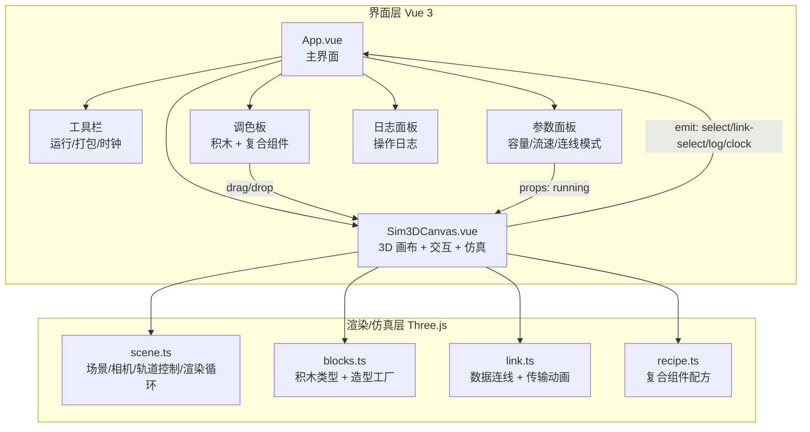
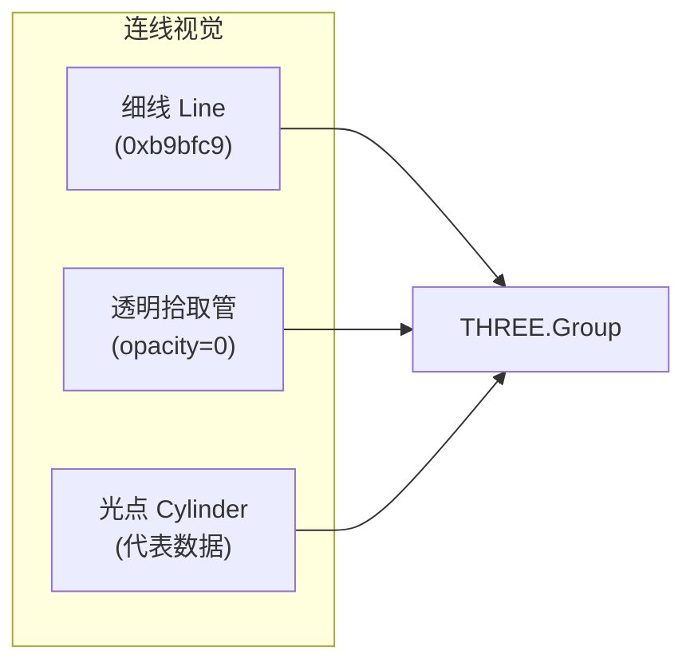
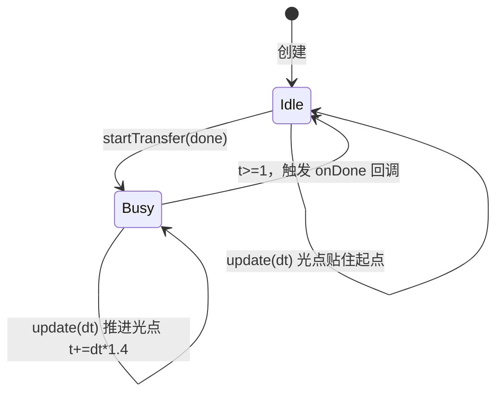
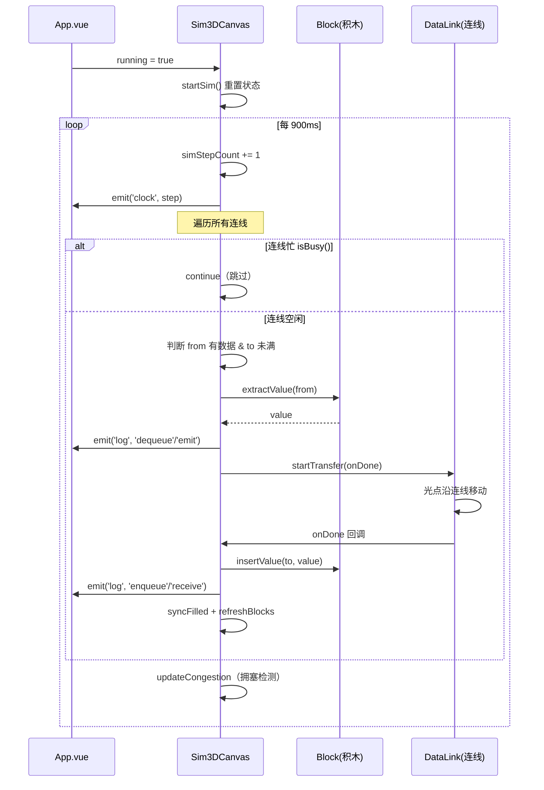
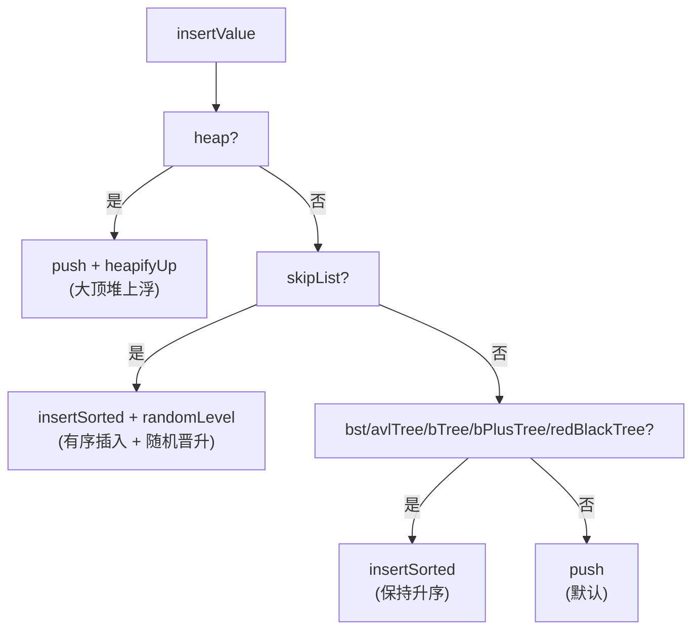
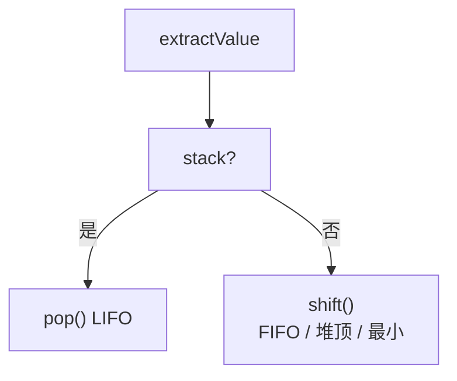
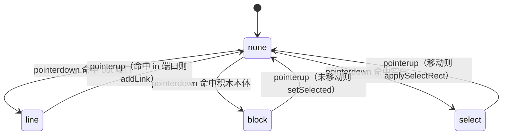
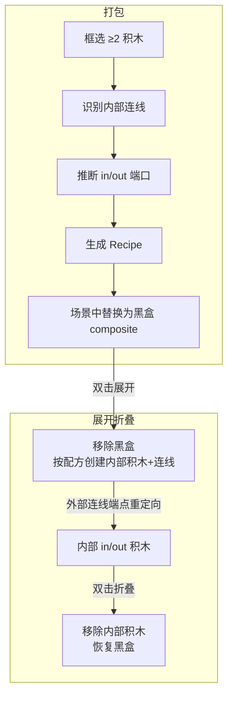
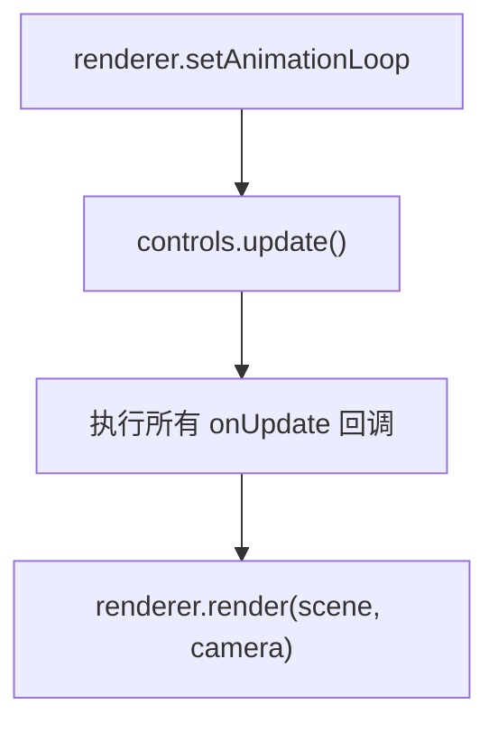

# 架构设计文档（Architecture）

> 数据结构 3D 仿真器（data-structure-sim）的技术架构说明。

## 1. 设计目标

1. **积木式建模**：用「拖拽 + 连线」的方式自由组合数据结构，无需写代码即可搭建数据流水线。
2. **语义化仿真**：尽可能还原各数据结构的真实存取行为（LIFO、FIFO、堆上浮、有序插入等）。
3. **可视化反馈**：通过 3D 造型、光点动画、颜色高亮、拥塞闪烁直观呈现数据流动状态。
4. **可扩展性**：新增积木、连线模式、复合组件外观的成本低。

---

## 2. 系统分层

系统分为 **界面层（Vue）** 与 **渲染/仿真层（Three.js）** 两层，通过 props / events 通信。



---

## 3. 模块职责

| 模块 | 文件 | 职责 |
| --- | --- | --- |
| 应用入口 | `src/main.ts` | 挂载 Vue 应用，引入全局样式 |
| 主界面 | `src/App.vue` | 组合各面板，管理 UI 状态（运行态、选中积木、日志、时钟） |
| 3D 画布 | `src/components/Sim3DCanvas.vue` | 场景内交互（拾取/拖拽/框选/连线）、仿真引擎、复合组件展开/折叠 |
| 场景 | `src/three/scene.ts` | 创建正交俯视场景、轨道控制、渲染循环、响应式缩放 |
| 积木 | `src/three/blocks.ts` | 积木类型系统、参数元信息、3D 造型工厂 |
| 连线 | `src/three/link.ts` | 连线视觉、拾取、数据传输动画 |
| 配方 | `src/three/recipe.ts` | 复合组件配方数据结构与预置库 |

---

## 4. 数据模型

```ts
// 积木类型（21 种）
type BlockType =
  | 'source' | 'sink' | 'composite'
  | 'array' | 'stack' | 'queue' | 'linkedList'
  | 'hashMap' | 'skipList' | 'tree'
  | 'bTree' | 'bPlusTree' | 'redBlackTree' | 'bst' | 'avlTree'
  | 'deque' | 'circularQueue' | 'trie' | 'unionFind' | 'heap' | 'graph';

// 积木参数
interface BlockParams {
  capacity: number;   // 容量
  filled: number;     // 当前数据量
  speed?: number;     // 源节点流速 / 汇节点消耗速度
  values?: number[];  // 当前存储的具体数据值
  skipLevels?: number[]; // 跳表晋升层数
}

// 积木实例
interface BlockInstance {
  group: THREE.Group;   // 3D 节点
  inPort: THREE.Vector3; // 输入端口局部坐标
  outPort: THREE.Vector3; // 输出端口局部坐标
}

// 连线接口
interface DataLink {
  group: THREE.Group;
  update(dt: number): void;          // 每帧刷新端点 + 推进光点
  startTransfer(onDone: () => void): void; // 启动传输
  isBusy(): boolean;                 // 是否在传输中
  setHighlight(hl: boolean): void;   // 选中高亮
  setStore(store: boolean): void;    // 存储模式切换
}

// 复合组件配方
interface Recipe {
  name: string;
  blocks: RecipeBlock[];  // 内部积木
  links: RecipeLink[];    // 内部连线
  inPort: number;         // 对外输入端口 → 内部积木 index
  outPort: number;        // 对外输出端口 → 内部积木 index
  shape?: 'box' | 'bucket';
}
```

场景内部的运行时数据结构（`Sim3DCanvas.vue`）：

```ts
interface SceneBlock {
  id: number;
  type: BlockType;
  params: BlockParams;
  group: THREE.Group;
  inTransit: number;   // 正在连线上的数据量
  values: number[];    // 当前数据
  skipLevels: number[];
}

interface PortEntry {
  mesh: THREE.Mesh;
  kind: 'in' | 'out';
  blockId: number;
}

interface SceneLink {
  fromBlockId: number;
  toBlockId: number;
  mode: 'transfer' | 'store';
  data: DataLink | null;
  group: THREE.Group | null;
  cleanup: (() => void) | null;
}
```

---

## 5. 积木造型系统

每个积木由基础几何体（格子、填充块、圆点、数字 Sprite、连线）拼装而成，并拥有独立布局算法：

| 积木 | 布局算法 |
| --- | --- |
| 数组 | 一排槽位，`filled` 个填充 |
| 栈 | 纵向槽位，顶在近端 |
| 队列 | 横排槽位，队首在右、从右向左填充 |
| 链表 | 圆点 + 顺序连线 |
| 哈希表 | `key % 桶数` 散落到桶 |
| 跳表 | 三层索引，按 `skipLevels` 晋升 |
| 树 | 固定坐标层序填充（最多 7 节点） |
| BST | 升序插入退化为右斜链 |
| AVL / 红黑树 | `generateTreeLayout` 层级布局 + `inorderToLevelOrder` 中序映射 |
| B 树 | 根 3 个分隔键 + 4 个子节点按区间 |
| B+ 树 | 根索引（路由键）+ 叶子链表 |
| 堆 | 金字塔排列 |
| 图 | 中心节点 + 环形分布 + 边 |
| 源/汇 | 圆形卡片，仅一个端口 |

**数字标签**：通过 `CanvasTexture` 绘制文字到 `THREE.Sprite`，避免使用昂贵的字体模型。

---

## 6. 连线与传输动画



**端点动态绑定**：`createDataLink` 通过 `getFrom` / `getTo` 回调在每帧读取端口世界坐标，因此积木移动时连线自动跟随。

**传输状态机**：



---

## 7. 仿真引擎

### 7.1 驱动方式

```ts
// 运行 → 每 900ms 执行一步
simTimer = window.setInterval(simStep, 900);
```

### 7.2 单步时序



### 7.3 结构语义

**插入 `insertValue(block, value)`**：



**取出 `extractValue(block)`**：



### 7.4 拥塞检测

```ts
hasData = from.type === 'source'
  ? from.values.length > 0 && step % speed === 0
  : from.values.length - from.inTransit > 0 && !isStoreTarget;
toFull = to.type === 'sink' ? false : to.values.length >= to.capacity;
// hasData && toFull → from 积木显示红色闪烁框
```

---

## 8. 交互系统

### 8.1 拾取（Raycaster）

三种拾取目标通过 `THREE.Raycaster` 与 `pointer`（NDC 坐标）命中：

- `pickPort`：命中端口圆点（`userData.portKind`）；
- `pickBlock`：遍历所有积木的 mesh，命中后映射回 `blockId`；
- `pickLink`：命中连线的透明拾取管（`userData.isPick`）。

### 8.2 拖拽状态机



### 8.3 框选与打包

```
空白拖拽 → 屏幕矩形 → raycastToClient 转世界坐标
  → 判断积木位置是否在矩形内 → selectedIds
  → 绿色高亮框 → 点「打包」→ packSelected → Recipe
```

---

## 9. 复合组件机制



**关键实现点**：
- 展开时 `expandedMap` 记录 `{ position, recipe, innerIds, innerLinks, inLinks, outLinks }`；
- 外部入边 `toBlockId` 重定向到 `innerIds[recipe.inPort]`，外部出边 `fromBlockId` 重定向到 `innerIds[recipe.outPort]`；
- 折叠时反向重定向回新黑盒 id。

---

## 10. 场景与渲染循环



- **相机**：`OrthographicCamera`，`frustumSize = 22`，俯视 `(0, 20, 0)`，`up = (0, 0, -1)`；
- **控制**：`OrbitControls` 禁用旋转，仅平移/缩放；
- **响应式**：`ResizeObserver` 监听容器，动态更新相机投影矩阵与渲染尺寸；
- **回调管理**：`onUpdate(fn)` 注册每帧回调并返回注销函数，用于连线动画、拥塞闪烁等。

---

## 11. 生命周期与资源清理

`Sim3DCanvas.vue` 的 `onBeforeUnmount` 负责：

1. `stopSim()` 停止仿真定时器；
2. 移除键盘/双击事件监听；
3. 遍历连线调用 `cleanup()` 注销动画回调；
4. 清除临时连线、选中框、拥塞框；
5. `scene3d.dispose()`：断开 ResizeObserver、停止渲染循环、释放 renderer、移除 canvas。

---

## 12. 扩展点

| 扩展目标 | 修改位置 |
| --- | --- |
| 新增积木类型 | `blocks.ts`（类型/参数/造型/switch）+ `Sim3DCanvas.vue`（存取语义）+ `App.vue`（BLOCKS 列表） |
| 新增连线模式 | `link.ts`（视觉/状态）+ `Sim3DCanvas.vue`（模式处理） |
| 新增复合组件外观 | `blocks.ts` 的 `createCompositeBlock` + `recipe.ts` 的 `Recipe.shape` |
| 预置复合组件 | `recipe.ts` 的 `RECIPES` |
| 调整仿真节奏 | `Sim3DCanvas.vue` 的 `setInterval` 间隔 |
| 新增渲染效果 | `scene.ts` 的 `onUpdate` 回调体系 |
