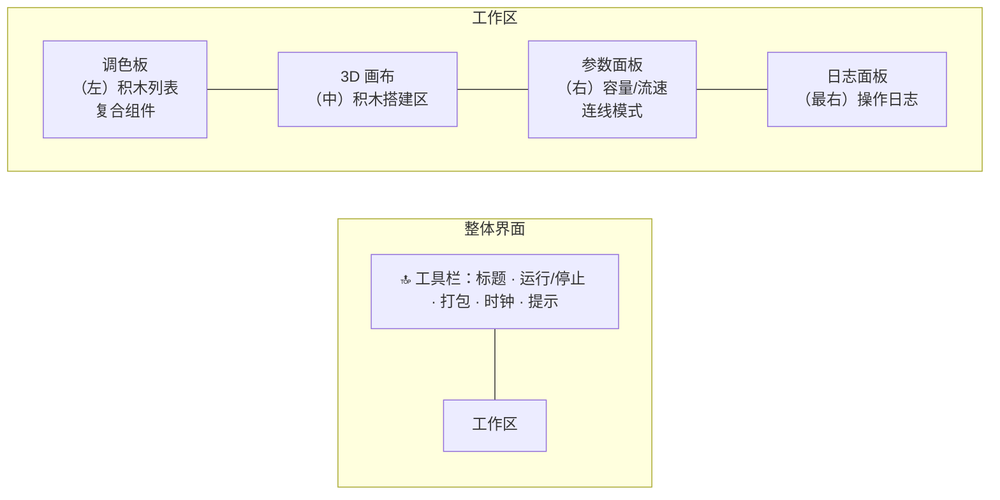

# 用户手册（User Guide）

> 数据结构 3D 仿真器的使用指南。

## 1. 安装与启动

### 环境要求

- Node.js 18+（建议 20+）
- 现代浏览器（支持 WebGL）

### 安装运行

```bash
npm install      # 安装依赖
npm run dev      # 启动开发服务器
```

启动后，在浏览器打开终端提示的地址（默认 `http://localhost:5173`）。

其他命令：

```bash
npm run build     # 类型检查 + 构建生产版本
npm run preview   # 预览构建产物
npm test          # 运行单元测试
```

---

## 2. 界面布局



| 区域 | 说明 |
| --- | --- |
| 工具栏 | 运行/停止按钮、打包按钮、步数时钟、操作提示 |
| 调色板 | 20+ 种数据结构积木 + 已创建的复合组件 |
| 3D 画布 | 俯视网格场景，积木拖拽、连线、框选在此完成 |
| 参数面板 | 显示选中积木的参数滑杆，或选中连线的模式选择 |
| 日志面板 | 实时记录每一步的数据流动事件 |

---

## 3. 快速上手（30 秒搭建第一个流水线）

1. 从调色板点击或拖拽 **「源节点 📤」** 到画布；
2. 同样方式添加 **「队列 🚶」** 和 **「汇节点 📥」**；
3. 从源节点的 **橙色端口** 拖一条线到队列的 **蓝色端口**；
4. 从队列的 **橙色端口** 拖一条线到汇节点的 **蓝色端口**；
5. 点击工具栏 **「▶ 运行」**，观察：
   - 光点沿连线流动；
   - 队列积木逐渐被数据填充；
   - 日志面板记录「投递 → 入队 → 出队 → 接收」。

点击 **「⏸ 停止」** 结束仿真。

---

## 4. 基本操作

### 4.1 添加积木

| 操作 | 效果 |
| --- | --- |
| 点击调色板积木 | 在画布自动网格位置创建 |
| 拖拽调色板积木到画布 | 在鼠标落点创建 |
| 拖拽复合组件到画布 | 在落点创建黑盒组件 |

### 4.2 连线

- **方向**：从 **橙色端口（输出）** 拖到 **蓝色端口（输入）**；
- 拖动过程中显示橙色临时线；
- 松开鼠标时若命中目标端口则建立连线；
- 连线端点跟随积木移动，自动保持连接。

> ⚠️ 不能从输入端口发起连线，也不能连回自己。

### 4.3 选中与移动

| 操作 | 效果 |
| --- | --- |
| 点击积木 | 选中（蓝色高亮），参数面板显示其参数 |
| 拖动积木 | 移动积木位置，相关连线自动跟随 |
| 点击连线 | 选中连线，可切换传输/存储模式 |
| 点击空白处 | 取消选中 |

### 4.4 删除

- 选中积木或连线后，按 `Delete` 或 `Backspace` 删除；
- 删除积木会同时删除其所有关联连线。

---

## 5. 进阶操作

### 5.1 框选与多选

- 在空白处按下并拖动鼠标，拉出虚线矩形；
- 矩形内的积木被绿色高亮框标记；
- 用于后续「打包」操作。

### 5.2 打包复合组件

1. 框选 **至少 2 个** 积木；
2. 点击工具栏 **「📦 打包」**；
3. 输入组件名称（如「缓存管道」）；
4. 选中的积木被替换为一个 **黑盒复合组件**；
5. 该组件出现在调色板「复合组件」区，可重复拖入使用。

**自动端口推断**：
- 输入端口 → 内部没有入边的积木；
- 输出端口 → 内部没有出边的积木。

### 5.3 展开 / 折叠复合组件

- **双击** 复合组件，将其展开为内部积木与连线，便于查看内部结构；
- 再次 **双击** 内部任意积木，折叠回黑盒。

### 5.4 连线模式

选中连线后，参数面板可切换：

| 模式 | 行为 | 连线颜色 |
| --- | --- | --- |
| 传输（消耗） | 数据从上游取出，转移到下游 | 灰色（默认） |
| 存储（持久化） | 作为存储目标，数据不被消耗 | 紫色 |

---

## 6. 参数调节

选中积木后，在参数面板通过滑杆调节：

| 积木 | 参数 | 范围 | 说明 |
| --- | --- | --- | --- |
| 源节点 | 消息数 | 1–20 | 可产生的消息总量 |
| 源节点 | 流速 | 1–10 | 发送间隔（1=最快） |
| 汇节点 | 消耗速度 | 1–10 | 吸收速度（1=最快） |
| 数组 | 长度 | 1–8 | 槽位数量 |
| 栈 / 队列 | 容量 | 1–6 | 可存储数据量 |
| 链表 | 节点数 | 1–6 | 节点数量 |
| 哈希表 | 桶数 | 1–6 | 哈希桶数量 |
| 跳表 | 元素数 | 1–12 | 元素数量 |
| 树 | 层数 | 1–3 | 树的深度 |
| B 树 | 键数 | 1–12 | 键的数量 |
| B+ 树 | 键数 | 1–20 | 键的数量 |
| 红黑树 / BST / AVL | 节点数 | 1–12 | 节点数量 |
| 双端队列 / 循环队列 | 容量 | 1–8 | 可存储数据量 |
| 字典树 | 键数 | 1–12 | 键的数量 |
| 并查集 | 元素数 | 1–8 | 元素数量 |
| 堆 | 元素数 | 1–10 | 元素数量 |
| 图 | 节点数 | 2–6 | 节点数量 |

调节后造型实时刷新，「当前数据量」显示积木现有数据个数。

---

## 7. 数据结构积木一览

| 名称 | 图标 | 存取语义 |
| --- | --- | --- |
| 源节点 | 📤 | 产生数据 |
| 汇节点 | 📥 | 吸收数据 |
| 数组 | 🔢 | 连续存储，随机访问 |
| 栈 | 📚 | LIFO（后进先出） |
| 队列 | 🚶 | FIFO（先进先出） |
| 链表 | 🔗 | 指针串联 |
| 哈希表 | 🗂️ | 按 `key % 桶数` 散列 |
| 跳表 | ⛷️ | 有序 + 多层索引 |
| 树 | 🌳 | 层序填充 |
| B 树 | 🅱️ | 多路平衡 |
| B+ 树 | ➕ | 索引 + 叶子链表 |
| 红黑树 | 🔴 | 红黑节点交替 |
| 二叉搜索树 | 🌲 | 升序插入退化为斜链 |
| AVL 树 | ⚖️ | 平衡布局 |
| 双端队列 | ↔️ | 两端进出 |
| 循环队列 | 🔄 | 环形缓冲 |
| 字典树 | 🔤 | 按十位前缀分组 |
| 并查集 | 👥 | 按 `v % 3` 分组 |
| 堆 | ⛰️ | 大顶堆（上浮） |
| 图 | 🕸️ | 中心 + 环 + 边 |
| 复合组件 | 🧩 | 打包的子图 |

---

## 8. 示例场景

### 8.1 经典「源 → 队列 → 汇」

观察 FIFO 行为：数据按进入顺序离开队列。

### 8.2 「源 → 栈 → 汇」

观察 LIFO 行为：后进入的数据先离开。

### 8.3 观察拥塞

将下游积木容量调小，或让源流速快于汇消耗速度，上游积木出现 **红色闪烁框**，提示数据滞涩。

### 8.4 复合组件复用

将「源 → 队列 → 汇」打包为「缓存管道」，再拖入多个副本并联运行。

---

## 9. 常见问题（FAQ）

**Q：为什么数据不动了？**
A：检查是否出现红色拥塞框——下游已满导致滞涩；或检查连线是否断掉、是否在存储模式。

**Q：如何让数据流更快？**
A：将源节点「流速」调小（1=最快），或将汇节点「消耗速度」调小。

**Q：复合组件如何查看内部？**
A：双击复合组件展开；双击内部积木折叠回黑盒。

**Q：如何删除连线？**
A：点击连线选中，按 `Delete` / `Backspace`。

**Q：可以旋转视角吗？**
A：当前为 2D 俯视视角，仅支持平移（拖空白处）与缩放（滚轮/手势），不支持旋转。
